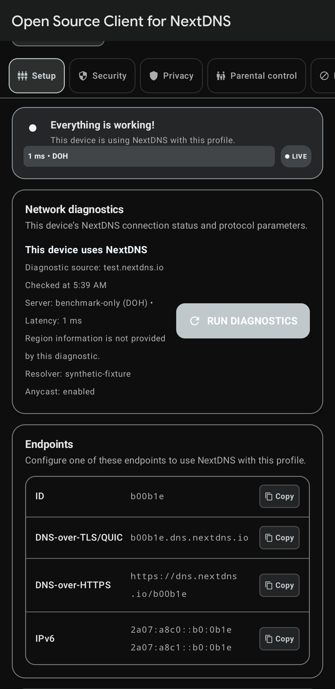
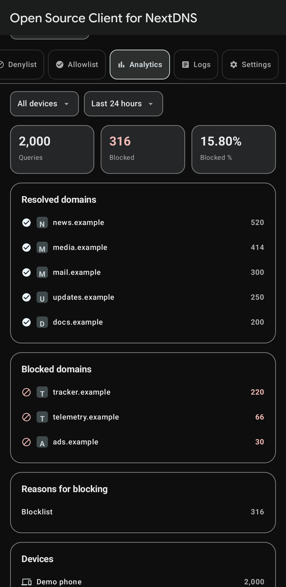

  

# Open Source Client for NextDNS

An independent Android app for managing NextDNS profiles. Change your filtering rules, find out why a domain was blocked, and check whether your phone is using NextDNS.

[**Download the beta APK**][apk] · [Release notes and checksums][release] · [Türkçe](README.tr.md)

Requires Android 7.0 or later. Connecting your own profiles requires a NextDNS account.

## Getting started

1. Download and open the [beta APK][apk] on your Android device. If Android asks whether your browser or file manager can install apps, allow it for the installation.
2. To look around without connecting an account, select **Explore in demo / guest mode**.
3. To manage your profiles, copy the API key at the bottom of [your NextDNS account page](https://my.nextdns.io/account), enter it in the app, and select a profile. This key gives the app access to your NextDNS account.

Connecting the account lets you manage profiles. To send your phone’s DNS queries through NextDNS as well, follow the instructions under **Setup**. On Android 9 or later, **Open Android Private DNS settings** takes you to the system setting where you can enter the profile’s address.

## Explore the app

The screenshots use sample data. Select an image to view it at full size.

### Find out why a domain was blocked

Open **Logs** when a site or app cannot connect. Search for its domain and check the outcome and the reason shown for a blocked query. Filter by device or time range to narrow the search. You can export the logs as a CSV file.

### Check the connection

Open **Setup** and select **Run diagnostics**. The result shows whether the device is using NextDNS and, when available, the connection protocol and latency.

### Review query totals

Open **Analytics** to see which domains were queried most and how many queries NextDNS blocked. Choose a device and a time range to focus the summary.

## Profile settings and data

Use **Security**, **Privacy**, and **Parental control** to review and change the selected profile’s filtering rules. Set domain-level exceptions in **Allowlist** and **Denylist**. The interface is available in English, Turkish, German, French, and Spanish.

NextDNS operates the DNS service and provides the accounts. The app connects directly to NextDNS and stores the API key encrypted on the device. When loading a site icon, it may send the displayed domain to NextDNS’s icon service.

## Support and development

- [Report a bug](https://github.com/illetyus/open-source-client-for-nextdns/issues). Include the app version, Android version, and the steps that led to the error. Omit API keys, profile identifiers, and DNS logs from public reports.
- [Report a security issue](SECURITY.md).
- [Build and test the app](docs/README.md#build-and-verify) or read the [contribution guide](CONTRIBUTING.md).

The source code is available under the [Apache License, Version 2.0](LICENSE). See [NOTICE](NOTICE) for third-party attributions.

[apk]: https://github.com/illetyus/open-source-client-for-nextdns/releases/download/v1.0.0-beta.1/open-source-client-for-nextdns-v1.0.0-beta.1.apk
[release]: https://github.com/illetyus/open-source-client-for-nextdns/releases/tag/v1.0.0-beta.1
