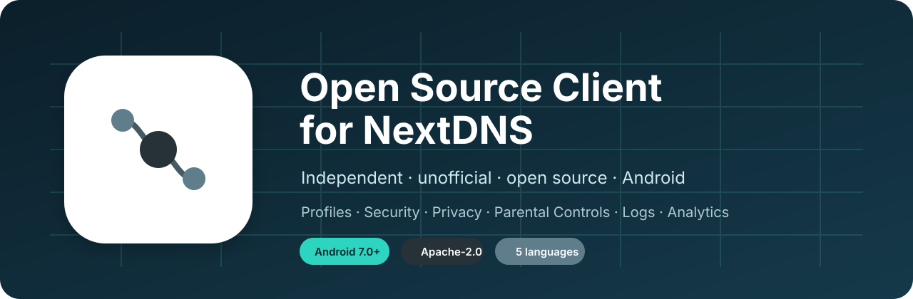

<p align="center">
  
</p>

<h1 align="center">Open Source Client for NextDNS</h1>

<p align="center">
  An independent, unofficial open-source Android client for managing a NextDNS account through the public NextDNS API.
</p>

<p align="center">
  <a href="https://github.com/illetyus/open-source-client-for-nextdns/actions/workflows/ci.yml"></a>
  <a href="https://github.com/illetyus/open-source-client-for-nextdns/actions/workflows/security.yml"></a>
  <a href="LICENSE"></a>
  
  
</p>

> [!IMPORTANT]
> This project is **not affiliated with, sponsored by, endorsed by, or officially supported by NextDNS**. NextDNS, its service, API, name, and trademarks belong to their respective rights holders.

## What it does

Open Source Client for NextDNS is an Android account-management client. It connects directly from the device to the NextDNS API using credentials supplied by the user; the project does not operate a separate backend that receives users' API keys or DNS histories.

- Manage NextDNS profiles and configuration.
- Review security, privacy, and parental-control settings.
- Maintain allowlists and denylists.
- Inspect DNS logs and analytics exposed by the account API.
- Run connection diagnostics and open Android Private DNS settings when needed.
- Use opt-in notifications with account-bound local state.
- Export supported data through Android's document interfaces.
- Use the interface in English, Turkish, German, French, or Spanish.
- Run on Android 7.0 (API 24) and later.

This application is **not** a DNS resolver, VPN, subscription service, or replacement for the NextDNS infrastructure.

## Interface verification

The CI pipeline records Roborazzi screenshots for branding, localization, and large-text layouts. Those screenshots are retained as test evidence in the `ui-branding-screenshots` workflow artifact instead of being hand-edited marketing mockups.

## Release status

The Android feature set for the first `1.0` line is complete. GitHub release automation distinguishes between release candidates and stable releases:

- `vX.Y.Z-rc.N` tags create **pre-releases** after the draft-safe release checks pass.
- `vX.Y.Z` tags create **stable releases only if the final legal/publication gates pass**.
- Signed APK and AAB files are produced only when the release signing secrets are configured.
- CI-generated unsigned release artifacts are review evidence and must not be redistributed as production builds.

No stable GitHub release has been published yet. See [Releasing](docs/RELEASING.md) for the exact process.

## Security and privacy model

- API credentials are protected with Android Keystore-backed local encryption.
- Android backup/transfer handling, release manifest properties, runtime networking, logs, and package contents are checked by release-oriented tests and scripts.
- The app communicates with NextDNS-operated services directly; server-side processing remains governed by NextDNS.
- Real API keys, profile identifiers, and DNS query logs must never be posted in issues, screenshots, test fixtures, or CI output.

For the implementation threat model and reporting process, see [Security](SECURITY.md) and [Security Threat Model](docs/SECURITY_THREAT_MODEL.md).

## Build from source

### Requirements

- JDK 17
- Android SDK matching the project's `compileSdk`
- Git

```bash
git clone https://github.com/illetyus/open-source-client-for-nextdns.git
cd open-source-client-for-nextdns
chmod +x gradlew
./gradlew :app:assembleDebug --no-daemon
```

Run the main local verification set with:

```bash
./gradlew :app:lintDebug :app:testDebugUnitTest --no-daemon
python3 scripts/verify_localization.py
python3 scripts/verify_api_capability_matrix.py
python3 scripts/verify_legal_assets.py
```

The CI pipeline performs additional dependency, package, screenshot, runtime-security, and release-evidence checks. Release signing is documented separately in [docs/RELEASING.md](docs/RELEASING.md).

## Project structure

| Path | Purpose |
| --- | --- |
| `app/` | Android application, tests, resources, and bundled notices |
| `macrobenchmark/` | Performance and macrobenchmark harness |
| `scripts/` | Release, compliance, test-evidence, and verification tooling |
| `fastlane/metadata/android/` | Draft Google Play metadata for five locales |
| `docs/` | Architecture, release evidence, legal drafts, provenance, and project records |
| `.github/workflows/` | CI, security, and release automation |

Start with the [documentation index](docs/README.md) if you need deeper project records.

## Contributing

Issues and pull requests are welcome. Read [CONTRIBUTING.md](CONTRIBUTING.md) before submitting changes. Security-sensitive reports must follow [SECURITY.md](SECURITY.md) instead of being filed publicly.

## Release integrity

Release builds are designed to be reproducible from a tagged source state with explicit signing inputs, SHA-256 checksums, and GitHub artifact attestations. The release workflow pins third-party actions to commit SHAs and grants the workflow token only the permissions required for publishing and attestations.

## License

Original project code and project-authored documentation are licensed under the [Apache License 2.0](LICENSE). See [NOTICE](NOTICE) and [source/license provenance](docs/SOURCE_AND_LICENSE_PROVENANCE.md) for third-party notices and attribution boundaries.

The Apache-2.0 license does not grant rights to the NextDNS name, service, API, logos, or other third-party intellectual property.
