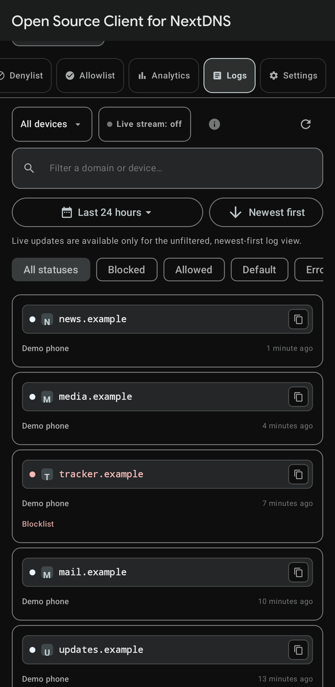

  
  <h1>Open Source Client for NextDNS</h1>
  
Manage your NextDNS profiles, review DNS activity, and check your connection from Android.

  
<a href="https://github.com/illetyus/open-source-client-for-nextdns/releases/tag/v1.0.0-beta.1"><strong>Download the beta</strong></a> · <a href="#getting-started">Getting started</a> · <a href="README.tr.md">Türkçe</a>

  
Android 7.0 or later · Apache 2.0

## A look at the app

  
  
  

From left to right, **Setup** checks the device’s NextDNS connection, **Logs** shows individual DNS queries and their filtering status, and **Analytics** summarizes activity over a selected period. The screenshots show the Android interface with synthetic account data.

## Getting started

1. Open the [beta release](https://github.com/illetyus/open-source-client-for-nextdns/releases/tag/v1.0.0-beta.1) and install the signed **APK** on your Android device.
2. To try the interface without connecting an account, select **Explore in demo / guest mode**.
3. To manage your own profiles, copy the API key from the bottom of your [NextDNS account page](https://my.nextdns.io/account), enter it in the app, and select a profile. The key authorizes the app to access your NextDNS account.

## What you can do

- Review and change a profile’s security, privacy and parental-control settings.
- Maintain lists of domains to allow or block.
- Filter DNS logs, export them as a CSV file, and review traffic summaries by time range or device.
- Run connection diagnostics and open Android’s Private DNS settings from the Setup screen.

The interface is available in English, Turkish, German, French and Spanish. NextDNS provides the DNS service and the accounts managed by this client. The project is independent of NextDNS.

## Data and support

The Android device connects directly to NextDNS. The app encrypts the API key on the device using Android Keystore. Loading site icons may send the displayed domain to NextDNS’s icon service. See the [security documentation](SECURITY.md) for the reporting channel and the [threat model](docs/SECURITY_THREAT_MODEL.md) for implementation details.

Report ordinary bugs in [GitHub Issues](https://github.com/illetyus/open-source-client-for-nextdns/issues). Remove API keys, profile identifiers and DNS histories from anything you share publicly.

## Development

The [documentation index](docs/README.md) covers building from source, testing and release preparation. [Contributing](CONTRIBUTING.md) describes how to submit changes. The source code is distributed under [Apache License 2.0](LICENSE). Third-party attribution is listed in [NOTICE](NOTICE).
