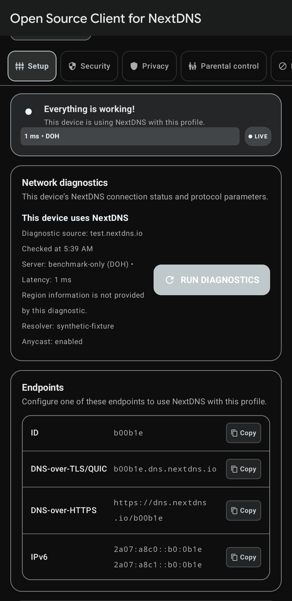
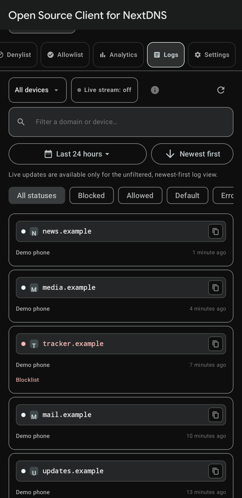
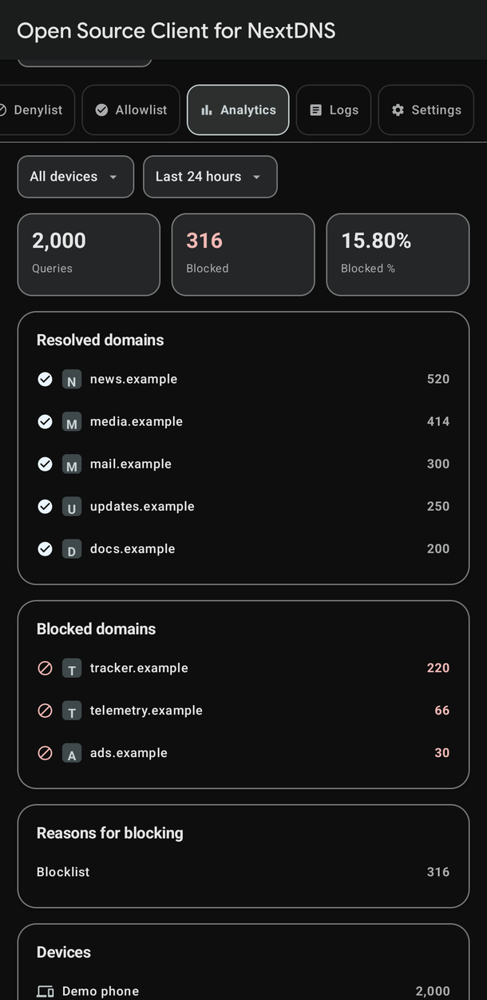

  
  <h1>Open Source Client for NextDNS</h1>
  
NextDNS profillerinizi Android’den yönetin, DNS sorgularını inceleyin ve cihazınızın bağlantısını denetleyin.

  
<a href="https://github.com/illetyus/open-source-client-for-nextdns/releases/tag/v1.0.0-beta.1"><strong>Beta sürümünü indir</strong></a> · <a href="#ilk-kurulum">İlk kurulum</a> · <a href="README.md">English</a>

  
Android 7.0 ve üzeri · Apache 2.0

## Uygulamanın görünümü

  
  
  

Soldan sağa **Kurulum**, cihazın NextDNS bağlantısını denetler. **Günlükler**, tek tek DNS sorgularını ve filtreleme sonuçlarını gösterir. **Analizler**, seçilen dönemin sorgu dağılımını özetler. Görseller, Android arayüzünün sentetik hesap verileriyle alınmış ekran görüntüleridir.

## İlk kurulum

1. [Beta sürüm sayfasındaki](https://github.com/illetyus/open-source-client-for-nextdns/releases/tag/v1.0.0-beta.1) imzalı **APK** dosyasını Android cihazınıza kurun.
2. Arayüzü hesap bağlamadan incelemek için **Demo / Misafir Modu ile Keşfet** seçeneğini kullanın.
3. Kendi profilinizi yönetmek için [NextDNS hesap sayfanızın](https://my.nextdns.io/account) altındaki API anahtarını uygulamaya girin ve bir profil seçin. API anahtarı, uygulamanın NextDNS hesabınıza erişmesini sağlar.

## Kullanım alanları

- Profilin güvenlik, gizlilik ve ebeveyn denetimi ayarlarını inceleme ve düzenleme.
- İzin verilen ve engellenen alan adları listelerini yönetme.
- DNS günlüklerini filtreleme, CSV dosyası olarak dışa aktarma ve sorgu özetlerini zaman aralığına veya cihaza göre inceleme.
- Bağlantı tanısını çalıştırma ve Kurulum ekranından Android’in Özel DNS ayarlarına erişme.

Arayüz Türkçe, İngilizce, Almanca, Fransızca ve İspanyolca kullanılabilir. Hesaplar ve DNS hizmeti NextDNS tarafından sağlanır. Uygulama NextDNS’ten bağımsız olarak geliştirilir.

## Veri akışı ve destek

Android cihazı NextDNS’e doğrudan bağlanır. Uygulama, API anahtarını Android’in anahtar deposunu kullanarak şifreler ve cihazda saklar. Site simgesi yüklenirken görüntülenen alan adı NextDNS’in simge hizmetine gönderilebilir. Güvenlik bildirim kanalı için [güvenlik belgesine](SECURITY.md), teknik kapsam için [tehdit modeline](docs/SECURITY_THREAT_MODEL.md) bakılabilir.

Olağan hataları [GitHub Issues](https://github.com/illetyus/open-source-client-for-nextdns/issues) üzerinden bildirebilirsiniz. Herkese açık paylaşımlardan API anahtarlarını, profil kimliklerini ve DNS günlüklerini çıkarın.

## Geliştirme

[Belge dizini](docs/README.md), kaynak koddan derleme, test ve sürüm hazırlama adımlarını içerir. Katkı süreci [katkı kılavuzunda](CONTRIBUTING.md) açıklanır. Kaynak kod [Apache License 2.0](LICENSE) ile sunulur. Üçüncü taraf atıfları [NOTICE](NOTICE) dosyasında yer alır.
